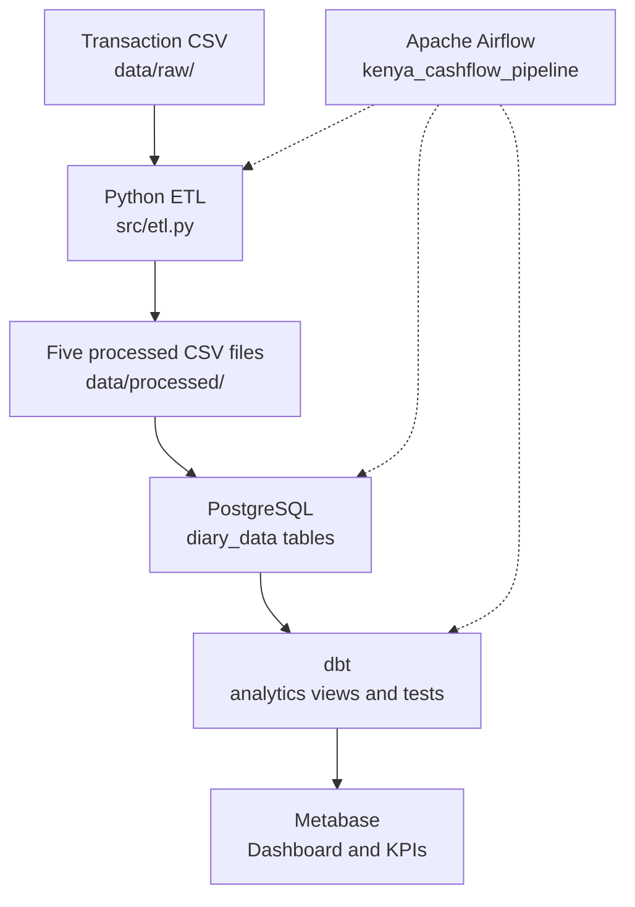
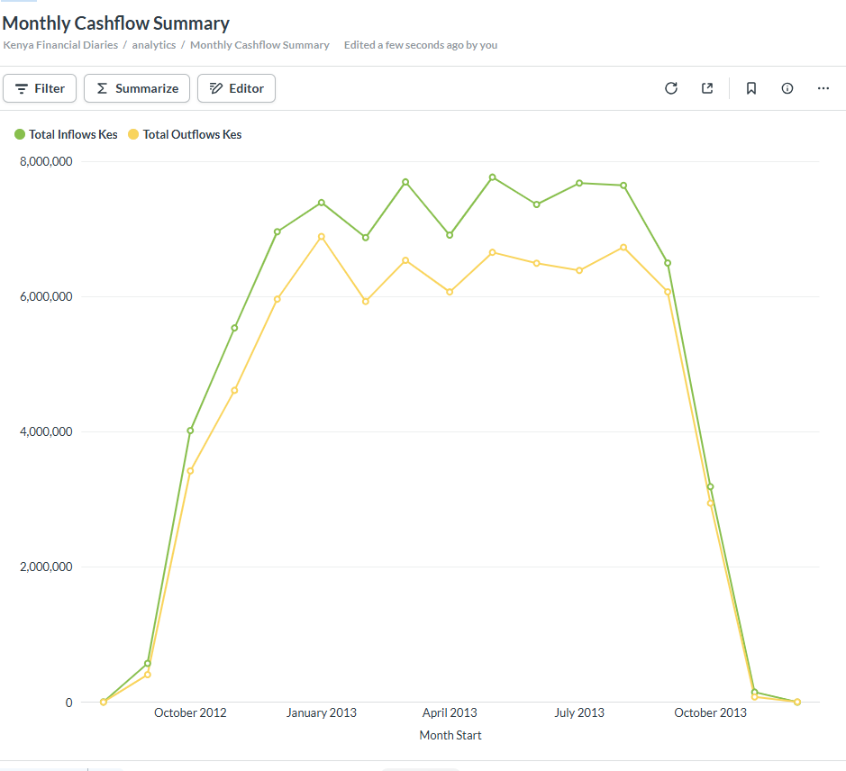
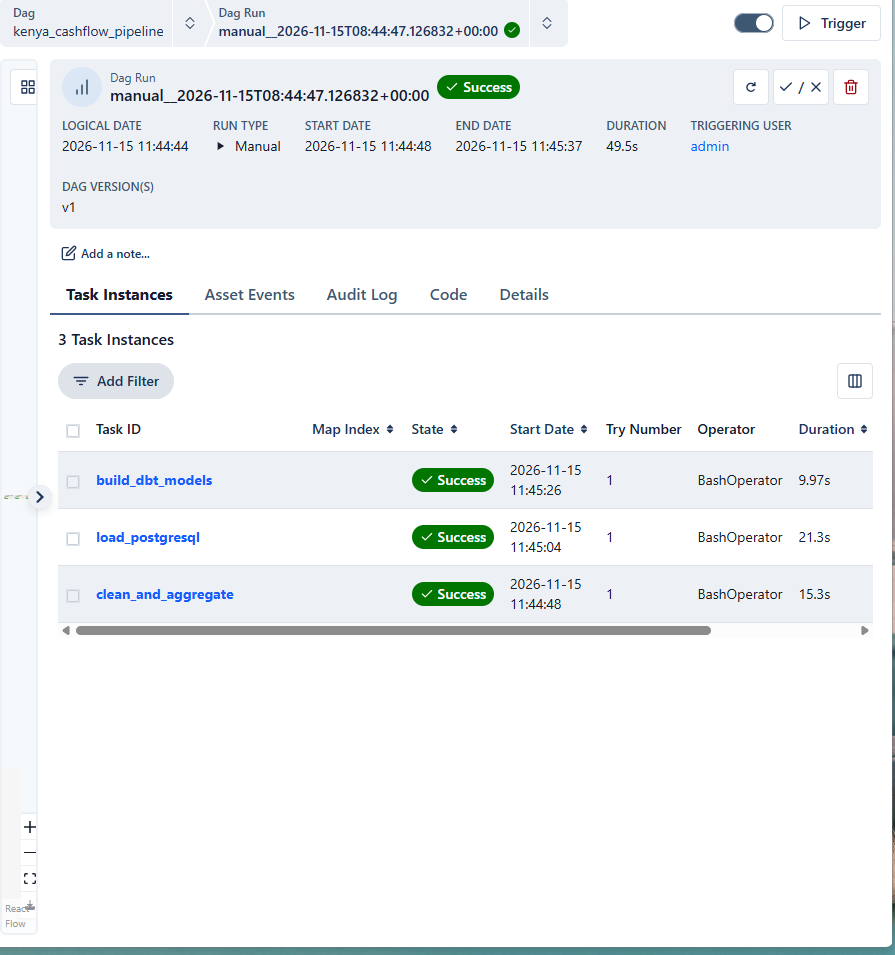

# Kenya Household Cash-Flow Data Pipeline

**An end-to-end data engineering project using the Kenya Financial Diaries dataset (2012–2013).**

This is my capstone project for building a repeatable data pipeline: starting with a large transaction file, cleaning and summarizing it in Python, loading the results into PostgreSQL, modelling them with dbt, running the workflow through Apache Airflow, and analyzing the results in Metabase.

## Project Overview

The Kenya Financial Diaries extract records financial activities for **298 households**. I used the transaction-level data to investigate how recorded monetary inflows, outflows, spending and financial activities changed over time.

The project began as an exploratory notebook and was converted into Python scripts and SQL models so the analysis can be rerun without repeating the notebook manually.

## Business Objective

The goal is to help **financial inclusion analysts and NGO programme managers** understand household cash-flow patterns and identify periods with unusual changes in financial activity.

The dashboard helps answer questions such as:

- How do recorded monetary inflows and outflows change by month or week?
- When do household-months show negative monetary margins?
- Which categories account for the largest recorded monetary spending?
- How frequently do households use financial mechanisms such as borrowing, deposits and withdrawals?
- How do financial patterns differ between individual households?

The data is historical, so the current dashboard is an **analytical demonstration**, not a live household monitoring system.

## Technology Stack

| Tool | What I used it for |
| --- | --- |
| **Python + pandas** | Inspect, clean, classify and summarize transaction data |
| **PostgreSQL** | Store the processed tables in the `diary_data` schema |
| **SQL + dbt** | Create reusable reporting views in the `analytics` schema and test them |
| **Apache Airflow** | Run ETL, database loading and dbt in the correct order; monitor failures |
| **Metabase** | Build charts, KPI cards and an interactive dashboard |
| **Git + GitHub** | Track and document the project code |
| **Ubuntu WSL2** | Run the development tools on my Windows computer |

## Pipeline Architecture



**What Airflow actually runs:** `clean_and_aggregate → load_postgresql → build_dbt_models`. Metabase is connected to PostgreSQL and reads the views created by dbt; it is not currently an Airflow task.

## Data Processing and Database Design

I investigated missing values, data types, financial transaction classifications and duplicate records before creating the reporting tables.

The ETL script produces five tables:

| Processed table | What one row represents | Rows |
| --- | --- | ---: |
| `household_daily` | A household on a recorded day | 94,335 |
| `household_weekly` | A household in a particular week | 16,115 |
| `household_monthly` | A household in a particular month | 4,076 |
| `spending_monthly` | Household × month × spending category × payment group | 35,973 |
| `financial_monthly` | Household × month × financial activity | 13,013 |

The PostgreSQL loader checks record counts and uses **composite primary keys** to prevent duplicate summary records. The loader refreshes the tables on reruns instead of adding another copy of each record.

The dbt project creates six views: `monthly_cashflow_summary`, `monthly_spending_by_category`, `monthly_financial_activity`, `weekly_cashflow_summary`, `household_trends`, and `household_overview`.

## Results and Data-Quality Checks

These results are from the processed project dataset:

| Measure | Result |
| --- | ---: |
| Households | **298** |
| Household-month observations | **4,076** |
| Negative-margin household-months | **1,411 (34.6%)** |
| Recorded core monetary inflows | **KES 86,218,659** |
| Recorded core monetary outflows | **KES 75,158,395** |
| Recorded core monetary margin | **KES 11,060,264** |
| dbt reporting views built | **6** |
| dbt tests passed | **16** |

**Monetary margin = eligible monetary inflows − eligible monetary outflows.** It is not the same thing as a household's income, savings, wealth or cash balance. The categories excluded from this measure are important when interpreting the results.

Some months have fewer recorded household observations than others. For that reason, a drop in total cash flow is **not automatically evidence** of a financial shock. Counts and observation coverage need to be considered alongside financial totals.

### Example SQL validation

```sql
SELECT
    SUM(household_months) AS household_months,
    SUM(negative_months) AS negative_months,
    SUM(total_margin_kes) AS overall_margin_kes
FROM analytics.monthly_cashflow_summary;
```

Expected output for this extract: **4,076 household-months**, **1,411 negative months**, and **KES 11,060,264** overall recorded core monetary margin.

## Metabase Dashboard

I created six visualizations: monthly inflows versus outflows; negative-margin months; spending by category; financial activity frequency; weekly cash-flow trends; and individual household trends. I also added household-count, household-month and negative-margin-share KPI cards.

### Monthly inflows versus outflows



*This is an actual chart from the local Metabase dashboard. Months with fewer observed households require cautious interpretation.*

## Apache Airflow Orchestration



On **15 November 2026**, the DAG completed one successful manual run. All three tasks passed:

1. `clean_and_aggregate` — executes the Python ETL script.
2. `load_postgresql` — loads the processed data into PostgreSQL.
3. `build_dbt_models` — executes `dbt build` to create reporting views and run tests.

During testing, the database-loading task initially failed because Airflow was attempting to connect as the default PostgreSQL user. I checked the Airflow task logs, set the correct `PGUSER` and other connection variables, and reran the workflow successfully. This also demonstrated why **environment configuration and task-level logging matter**.

The DAG currently uses `schedule=None`, so runs are **manual rather than automatically scheduled**.

## Project Structure

```text
kenya-household-cashflow/
├── README.md
├── .gitignore
├── requirements.txt
├── src/
│   ├── etl.py
│   └── load.py
├── data/
│   ├── raw/                  # local source data; not published
│   └── processed/            # generated outputs; not published
├── notebooks/                # exploration; review before publishing
├── kenya_cashflow_dbt/
│   ├── dbt_project.yml
│   ├── models/
│   └── tests/
└── docs/
    └── images/
```

The working Airflow DAG currently lives at `~/airflow/dags/kenya_cashflow_pipeline.py`, outside this project directory. Copy a reviewed, **credential-free** version into the Git repository (for example `airflow/dags/`) to version-control it.

## How to Run Locally

These instructions assume Ubuntu WSL2, an existing PostgreSQL database called `kenya_cashflow`, and authorized access to the source CSV.

**1. Activate the project environment**

```bash
cd ~/projects/kenya-household-cashflow
source .venv/bin/activate
```

**2. Start PostgreSQL and check the connection**

```bash
sudo service postgresql start
pg_isready -h 127.0.0.1 -p 5432
```

**3. Run the pipeline manually**

Set `PGUSER`, `PGPASSWORD`, `PGDATABASE`, `PGHOST` and `PGPORT` in your local environment. Do **not** put the database password in Git.

```bash
python src/etl.py
python src/load.py
cd kenya_cashflow_dbt
dbt build
```

**4. Orchestrate with Airflow**

Run Airflow in its separate virtual environment, then trigger `kenya_cashflow_pipeline` from `http://localhost:8080`.

```bash
source ~/airflow-venv/bin/activate
airflow standalone
```

**5. Explore the dashboard**

Run Metabase in another Ubuntu terminal and open `http://localhost:3000`.

```bash
cd ~/metabase
java -jar metabase.jar
```

Connect Metabase to PostgreSQL and explore the `analytics` schema. Saved Metabase questions/dashboard metadata are maintained by the local Metabase application and **are not automatically recreated by this Git repository**.

## Current Status

| Phase | Status |
| --- | --- |
| Project setup and business understanding | Complete |
| Data exploration and cleaning | Complete for current MVP |
| PostgreSQL load and primary-key checks | Complete |
| dbt reporting models and tests | **6 models, 16 tests passed** |
| Metabase charts and KPIs | Completed locally |
| Airflow DAG and manual end-to-end run | **3 tasks successful** |
| Scheduled runs and cloud deployment | Future work |
| Documentation and GitHub portfolio | In progress |

## Limitations and Next Steps

- This is a **historical study of 298 observed households**; results should not be generalized to all Kenyan households.
- Some amounts and financial labels need careful interpretation. In-kind and credit activity should not be automatically treated as cash spending.
- Financial margin is a descriptive measure, not a verified household savings balance or a diagnosis of distress.
- The project currently reloads prepared aggregates rather than implementing incremental processing.
- Future improvements include stronger reconciliation tests, coverage-adjusted comparisons, a scheduled DAG, and reproducible Metabase dashboard exports.

## Data and Privacy

The original transaction extract, generated CSV files, passwords, virtual environments and local application databases are **not included in the public repository**. Source dataset use and redistribution permissions should be checked before sharing any data. Screenshots should be reviewed for sensitive information before publication.

---

*Data engineering capstone · Python · PostgreSQL · dbt · Airflow · Metabase*
